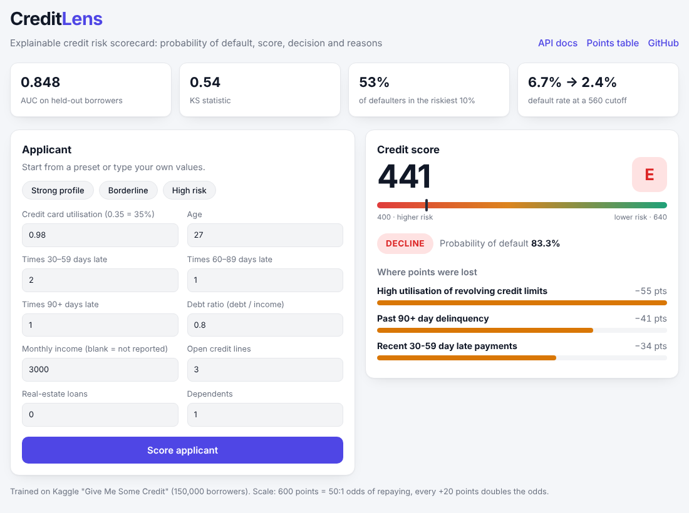
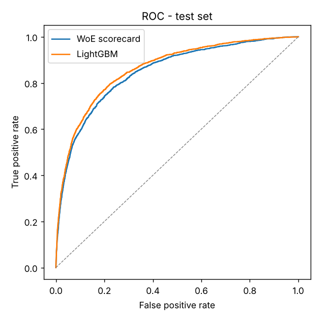
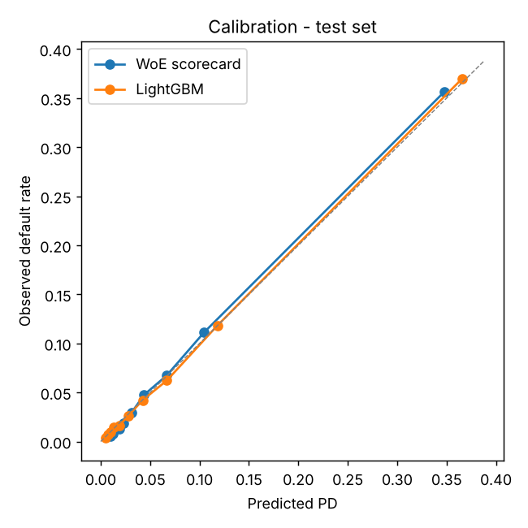
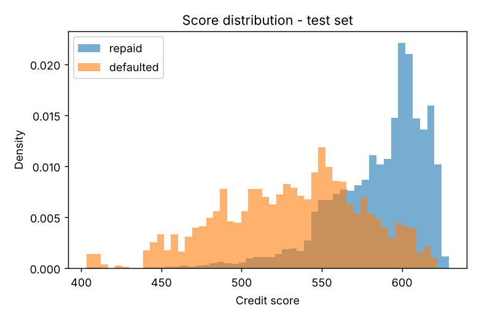

# CreditLens

**Live demo:** https://credi-score.onrender.com (free tier, first load can take ~50 s to wake up)



Credit risk scorecard on the Kaggle "Give Me Some Credit" dataset. Predicts if a borrower will be 90+ days late in the next 2 years, converts that into a credit score, and gives approve / manual review / decline with the reasons behind it.

I wanted to build it the way banks usually do it, so the main model is a WoE + logistic regression scorecard (easy to explain), and I trained LightGBM next to it to see how much accuracy I was giving up.

## Results

Test set: 29,878 borrowers, default rate 6.7%.

| model | AUC | Gini | KS |
|---|---|---|---|
| WoE scorecard | 0.848 | 0.696 | 0.544 |
| LightGBM | 0.862 | 0.724 | 0.573 |

Some things I found useful from the reports folder:

- The lowest-scoring 10% of applicants have 53% of all the defaulters.
- If you approve everyone with score >= 560, you approve 77.6% of people and the default rate in the approved group goes from 6.7% to 2.35%.
- With my current thresholds (approve if PD < 5%, decline if PD >= 15%): 68.5% approved (1.9% default), 22% manual review (8.9%), 9.5% declined (36.4%).
- Predicted PD is well calibrated: average 6.73% vs actual 6.70%.
- PSI between train and test scores is 0.0005. I also made a fake shifted sample where high-utilisation customers are 3x more likely to apply. Score PSI went to 0.164 and the utilisation feature alone to 0.255, so the drift check shows which feature caused it.





## How it works

**Cleaning.** Dropped 609 duplicate rows and one row with age 0. The past-due columns have values 96 and 98 which are codes, not real counts, so I set them to missing. 60/20/20 stratified split.

**WoE binning** (`binning.py`). I wrote this myself instead of using a library. Each feature starts as 20 quantile bins, then neighbouring bins get merged until the bad rate only goes in one direction, and each bin has at least 3% of the data. Missing values are a separate bin. Each bin gets a WoE value = ln(%good / %bad).

**Feature selection.** Kept features with IV >= 0.02 and checked WoE correlation (> 0.7 = drop the weaker one). Kept 8 of 10. debt_ratio (IV 0.018) and real_estate_loans (IV 0) got dropped. Both have a U-shaped relationship with default, so forcing monotonic bins kills them. LightGBM can still use them, which explains part of the AUC gap.

IV values: revolving_utilization 1.13, past_due_90_plus 0.84, past_due_30_59 0.72, past_due_60_89 0.56, age 0.26, open_credit_lines 0.09, monthly_income 0.07, dependents 0.04.

**Scoring.** Logistic regression on the WoE values, then scaled so that 600 points = 50:1 odds (good:bad) and +20 points doubles the odds. Each bin of each feature gets points (`reports/scorecard_points.csv`), and the score is just the sum.

**Reason codes.** For each applicant I compare their points on each feature with the best possible bin for that feature. The 3 features where they lost the most points are the reasons.

**LightGBM.** Raw features, early stopping on the validation set (stopped at 195 trees). Feature importance uses SHAP values from LightGBM's `pred_contrib`.

## Running it

```
pip install -r requirements.txt
pip install -e .
python -m creditlens.train
pytest
uvicorn creditlens.api:app --reload
```

`/` has a small form to try it, `/docs` has the Swagger page.

Data: if `data/cs-training.csv` (from Kaggle) exists it uses that, otherwise it loads the copy that comes with the `empulse` package.

Example:

```
curl -X POST http://127.0.0.1:8000/score -H "Content-Type: application/json" -d '{"revolving_utilization": 0.85, "age": 29, "past_due_30_59": 2, "past_due_60_89": 0, "past_due_90_plus": 0, "debt_ratio": 0.45, "monthly_income": 4200, "open_credit_lines": 7, "real_estate_loans": 0, "dependents": 1}'
```

returns score 511, PD 30.3%, decline. The main reasons are high utilisation (-49 pts), 30-59 day late payments (-34 pts) and age (-22 pts).

## Files

- `src/creditlens/data.py` - loading, cleaning, split
- `src/creditlens/binning.py` - WoE / IV
- `src/creditlens/scorecard.py` - feature selection, model, points, reason codes
- `src/creditlens/challenger.py` - LightGBM
- `src/creditlens/metrics.py` - AUC, Gini, KS, PSI, gains table, cutoffs
- `src/creditlens/policy.py` - thresholds
- `src/creditlens/train.py` - runs everything, writes reports/
- `src/creditlens/api.py` - FastAPI
- `tests/` - 23 tests on generated data

## Limitations / todo

- Random split only. The dataset has no dates, so I couldn't do an out-of-time test.
- Age is used because it's in the dataset, but it's a fairness concern for a real lender.
- Thresholds in policy.py are my picks, not optimised for profit.
- Data is US bureau data. Would like to try this on something closer to Indian credit data (CIBIL-style fields).
- Want to try a profit-based cutoff instead of fixed PD thresholds.
